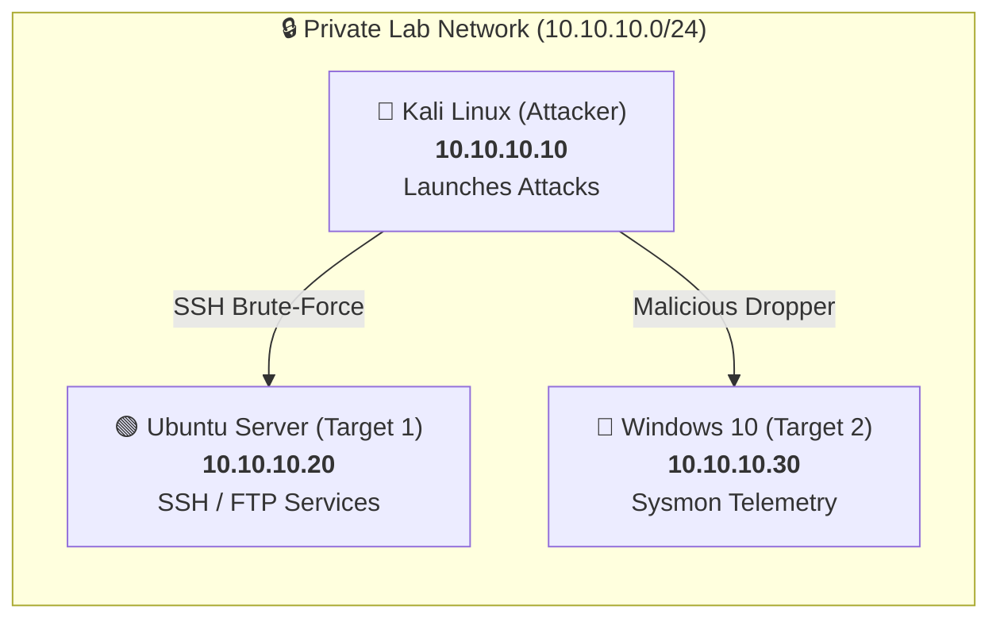
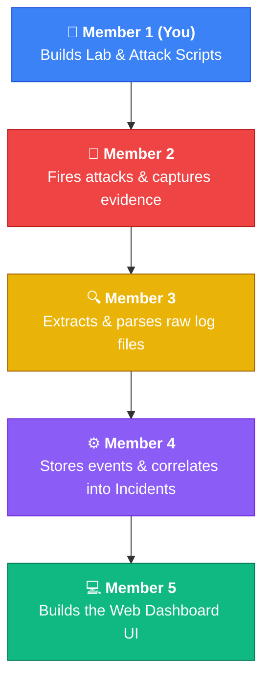
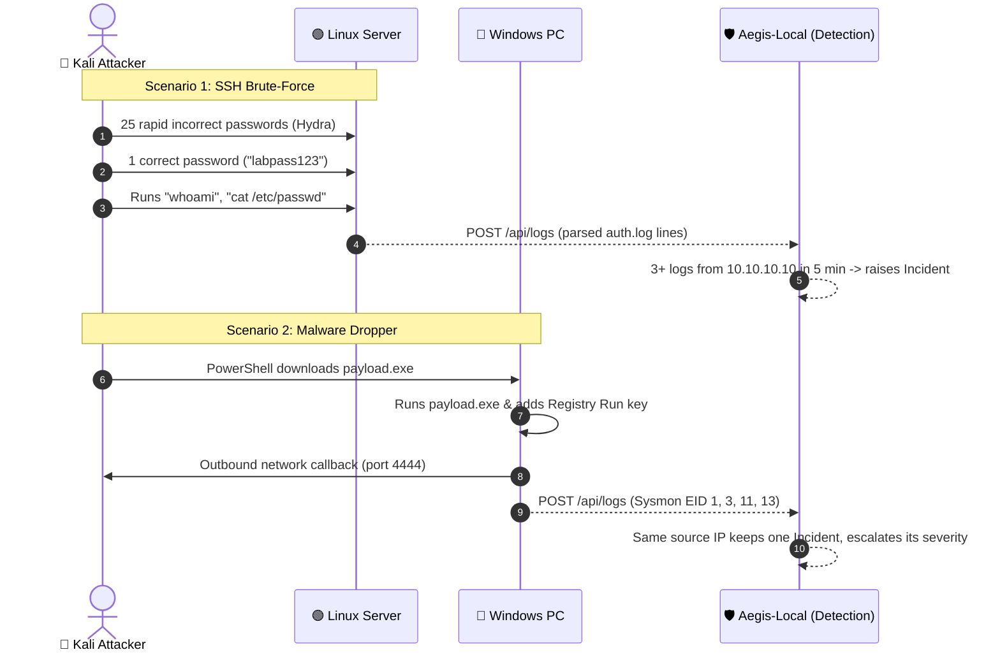

# 🛡️ AegisRange — Executive & Team Guide
### *Lightweight Attack Detection & Investigation Cyber Range*

---

> [!NOTE]
> **What is AegisRange in 1 Plain Sentence?**  
> AegisRange is a **safe, isolated practice lab** with 3 virtual computers where you launch simulated cyber attacks, capture the digital evidence, and watch a dashboard reconstruct exactly what happened and when.

---

## 🗺️ 1. The Virtual Lab (The 3 Machines)

Imagine three computers sitting in a closed room connected by a private network cable (`10.10.10.0/24`):

| Computer | IP Address | Role | Real-World Equivalent |
|---|---|---|---|
| **aegis-kali** | `10.10.10.10` | 🔴 **The Attacker** | External hacker testing system defenses |
| **aegis-linux** | `10.10.10.20` | 🟢 **Victim 1** | Company web/file server hosting critical services |
| **aegis-windows** | `10.10.10.30` | 🔵 **Victim 2** | Employee workstation PC running Windows |

---

## 👥 2. The 5 Team Roles & Workflow

The project is an **assembly line**: every member passes their work to the next member.

### Breakdown of Each Member's Job:

### 👑 Member 1 (YOU): Architecture + Red Team Lead
* **Your Output**: The Lab Setup (`Vagrantfile`), Network Plan, and Attack Automation Scripts.
* **In Simple Words**: You build the virtual arena and write the scripts that run the attacks.

### 🔴 Member 2: Red Team Operator
* **Their Output**: Attack execution, testing logs, and evidence screenshots.
* **In Simple Words**: They press the "fire" button on the attacks you wrote, document the exact times, and prove the attacks actually hit the targets.

### 🔍 Member 3: Detection Engineer
* **Their Output**: Log collectors and parsers.
* **In Simple Words**: They write small scripts that sit inside the victim machines, read the log files (`auth.log` on Linux, `Sysmon` on Windows), and turn messy text into neat JSON data.

### ⚙️ Member 4: Backend & Correlation (`main.py`)
* **Their Output**: Central `main.py` service with `POST /api/logs` and `GET /api/incidents`, backed by the SQLite file `app.db`.
* **In Simple Words**: They store logs and watch for noisy attackers. When **3 or more logs arrive from the same source IP inside 5 minutes**, they create an incident titled *"Suspicious activity from 10.10.10.10"*. More logs from that IP escalate its severity: `low` (3-4) → `medium` (5-9) → `high` (10+). Those three lowercase words are the only severities the database has.

### 💻 Member 5: Frontend Dashboard (Streamlit)
* **Their Output**: The Streamlit dashboard (`dashboard.py`).
* **In Simple Words**: **They build the dashboard!** Using Streamlit and pandas, they open Member 4's `app.db` with `sqlite3` and read the `incidents` and `raw_logs` tables **directly** — no HTTP calls to the API at all — to show metrics, incident cards, the log timeline and downloadable incident reports. They also write `status = "closed"` back into `app.db` when an incident has been triaged.

---

## ⚡ 3. The Two Attack Scenarios

---

## 🚀 4. How to Approach the Project (4-Week Step-by-Step)

> [!TIP]
> Do not try to build everything at once! Follow this step-by-step path:

### 📅 Week 1: Build the Foundation (Member 1 Focus)
* [x] **System Architecture**: Define IP addresses and API contracts. *(Already Done in `docs/`!)*
* [ ] **Spin up the VMs**: Install VirtualBox & Vagrant, and run `vagrant up`.
* [ ] **Check Connections**: Ping between Kali, Linux, and Windows using `tests/smoke/test-vm-connectivity.sh`.

### 📅 Week 2: Execute Attacks & Gather Evidence (Member 1 + Member 2)
* [ ] Run **Scenario 1** on Kali $\rightarrow$ verify `/var/log/auth.log` recorded the failed attempts.
* [ ] Run **Scenario 2** on Windows $\rightarrow$ verify Sysmon recorded the process and file creation.
* [ ] Member 2 saves sample log files to share with Member 3.

### 📅 Week 3: Pipeline Connection (Member 3 + Member 4)
* [ ] Member 3 writes collector scripts to send logs to Member 4's backend (`POST /api/logs` — one log per request; there is no batch endpoint).
* [ ] Member 4 writes detection rules that spot the attacks in the incoming data.

### 📅 Week 4: Final Web UI & Presentation (Member 4 + Member 5)
* [ ] Member 5 points the Streamlit dashboard (`streamlit run dashboard.py`) at Member 4's `app.db`.
* [ ] The team runs an attack live on Kali $\rightarrow$ watches the incident and log timeline appear on the dashboard at `http://localhost:8501`!

---

## 📚 5. Quick Cybersecurity Cheat Sheet

| Term | What it means in plain English |
|---|---|
| **Cyber Range** | A safe, isolated network sandbox used for cybersecurity training and testing. |
| **Telemetry** | The digital footprints and activity records left by computers (e.g. process starts, network connections). |
| **Sysmon** | Free Microsoft security tool that monitors Windows and logs deep details like file creation and command lines. |
| **Brute-Force** | An attack where software tries dozens or hundreds of passwords automatically until one works. |
| **Correlation** | Connecting multiple separate clues into **one single criminal story**. In AegisRange today that means: several logs from the same source IP inside one 5-minute window become a single incident. |
| **Kill Chain** | The sequence of steps an attacker takes: Download $\rightarrow$ Execute $\rightarrow$ Stay Persistent $\rightarrow$ Call Home. |
