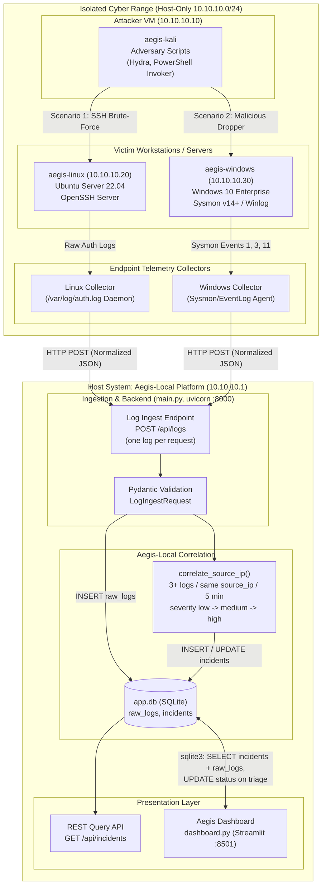
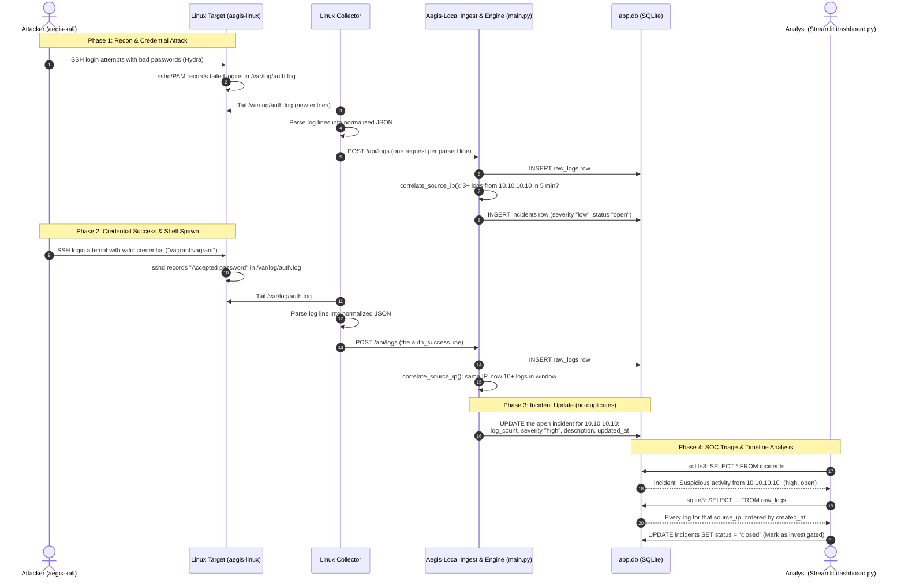

# AegisRange System Architecture

This document describes the architectural framework, component boundaries, data pipelines, technology decisions, and operational flows governing the **AegisRange** cyber range and the **Aegis-Local** detection and investigation platform.

> [!IMPORTANT]
> Sections 1–5 describe the system **as implemented on `main`**: a FastAPI service (`main.py`)
> with four routes, a single volume-threshold correlation rule, a SQLite file `app.db`, and a
> Streamlit dashboard (`dashboard.py`) that reads that file **directly with `sqlite3`** rather
> than over HTTP. Alert objects, a rule engine, MITRE persistence and timeline endpoints are
> future work — see [`api-contracts.md`](api-contracts.md) Part 2 for exactly what is and is
> not built.

---

## 1. System Overview & Component Diagram

AegisRange integrates an isolated virtual testing range with a host-resident Security Operations Center (SOC) stack consisting of telemetry agents, a detection and correlation backend, and an interactive forensic dashboard.



> [!NOTE]
> The dashboard is wired to `app.db`, **not** to `BackendAPI`. `dashboard.py` contains no
> HTTP client; `GET /api/incidents` exists for collectors, tests and future consumers. There
> is also no `GET /api/logs` of any kind, so reading logs back is only possible against the
> database file.

---

## 2. Technology Stack

| Layer | Component | Technology Selection | Justification & Architectural Fit |
| :--- | :--- | :--- | :--- |
| **Virtualization** | Hypervisor | Oracle VirtualBox 7.0+ | Cross-platform, free/open-source, stable host-only networking, scriptable via CLI (`VBoxManage`). |
| **Orchestration** | Infrastructure-as-Code | HashiCorp Vagrant 2.3+ | Declarative multi-VM definitions, predictable IP allocation, reproducible builds via shell/PowerShell provisioners. |
| **Attacker OS** | Adversary Node | Kali Linux 2023.x / 2024.x | Standardized offensive toolchain pre-packaged (Hydra, Nmap, Metasploit, Python requests). |
| **Target OS (Linux)** | Server Target | Ubuntu Server 22.04 LTS | Ubiquitous enterprise distribution; native `systemd`, `rsyslog`, standard PAM authentication logging (`auth.log`). |
| **Target OS (Windows)** | Client Target | Windows 10 Enterprise (Evaluation) | Standard corporate endpoint target, robust Sysinternals Sysmon telemetry and Windows Event Logging. |
| **Telemetry Agents** | Endpoint Forwarders | Python 3.10+ / PowerShell Core | Zero heavy external agent dependencies; small CPU/RAM footprint (<30MB RAM); resilient batched HTTP transport. |
| **Backend Runtime** | API & Engine | Python 3.10+, FastAPI + uvicorn (`main.py`) | Async API handling `POST /api/logs` and `GET /api/incidents`, with correlation inline on every ingest. Served with `uvicorn main:app` on port 8000. |
| **ORM & Migration** | Persistence Layer | SQLAlchemy 2.x (`models.py`, `database.py`) + `schema.py` | Declarative models plus a startup SQLite schema sync that backs the file up before rebuilding a changed table. |
| **Database** | Storage Engine | SQLite — `sqlite:///./app.db` | Single local file holding `raw_logs` and `incidents`. Shared by the API (SQLAlchemy) and the dashboard (`sqlite3`). PostgreSQL would work via `database.py`, but then `schema.py` only runs `create_all()` and Alembic is required. |
| **Frontend Framework** | Dashboard | Streamlit + pandas (`dashboard.py`) | Interactive dashboard on port 8501 showing incidents, log timeline, charts and Markdown/CSV exports. Reads `app.db` directly with `sqlite3`; no REST client. |

---

## 3. Data Flow Architecture

The data lifecycle in AegisRange follows an end-to-end 8-stage pipeline from adversarial execution to forensic triage:

```
[1. Attack Action] 
       │
       ▼
[2. Evidence Generation] ── (Kernel / Audit Subsystems)
       │
       ▼
[3. Telemetry Collection] ── (File tailing / Win32 API subscription)
       │
       ▼
[4. Schema Normalization] ── (Standardized Aegis Event JSON format)
       │
       ▼
[5. Rule Matching Engine] ── (MITRE ATT&CK detection logic)
       │
       ▼
[6. Temporal Correlation] ── (Sliding-window entity clustering)
       │
       ▼
[7. Incident Creation] ── (Composite state machine & database persistence)
       │
       ▼
[8. Dashboard Investigation] ── (Analyst visualization & timeline reconstruction)
```

### Stage Details

1. **Attack Execution**: An attacker script executes on `aegis-kali` (e.g., launching Hydra brute-force against port 22 of `aegis-linux`, or sending a malicious payload via WinRM/HTTP to `aegis-windows`).
2. **Evidence Generation**: The operating system kernel and service daemons record the interaction:
   - Linux: PAM subsystem and `sshd` write `Failed password for invalid user ...` or `Accepted password ...` entries to `/var/log/auth.log`.
   - Windows: Sysinternals Sysmon generates Event ID 1 (Process Create), Event ID 3 (Network Connection), and Event ID 11 (File Create).
3. **Telemetry Collection**: The local lightweight collector daemon tails target logs continuously. If disconnected from the host, events buffer in local memory queues to prevent loss.
4. **Schema Normalization**: Unstructured log lines (e.g., syslog text or XML Windows Event records) are transformed into the standardized Aegis JSON schema containing ISO 8601 timestamps, source identifiers, categorized event types, and structured key-value parsed attributes.
5. **Ingestion & Validation**: The collector sends one `POST /api/logs` per record. FastAPI validates it against `LogIngestRequest` (`source_ip`, `destination_ip`, `log_type`, `raw_data`) and inserts a `raw_logs` row. *Stages 5 and 6 in the diagram above are collapsed into this single step in the current code — there is no separate rule-matching pass and no alert object.*
6. **Temporal Correlation**: `correlate_source_ip()` counts `raw_logs` rows sharing the new log's `source_ip` with `created_at` inside the last `TIME_WINDOW` (5 minutes). Below `LOG_THRESHOLD` (3) nothing happens. Correlation keys on `source_ip` **only** — not on host, user or process.
7. **Incident Creation**: At or above the threshold, the open incident for that `source_ip` is refreshed, or one is created with `title = "Suspicious activity from <ip>"`. Severity comes from `SEVERITY_STEPS` by log count: `low` (3–4), `medium` (5–9), `high` (10+). Those three lowercase values are the only ones the model permits — **there is no `critical`**. Log and incident are committed in one transaction, and the log is marked `processed = True`.
8. **Dashboard Display & Investigation**: `dashboard.py` opens `app.db` with `sqlite3`, loads `incidents` and `raw_logs` into pandas, and renders KPIs, incident cards (each with the raw logs for its `source_ip`), a chronological log timeline, severity/status/type/hour charts, Markdown incident reports and a CSV export. Marking an incident investigated writes `status = "closed"` straight back to `app.db`.

---

## 4. Attack Scenario Sequence Diagram

The following sequence diagram details the full dataflow for **Scenario 1: SSH Brute-Force & Account Compromise**:



> [!NOTE]
> Phase 4 is deliberately drawn against `app.db`, not the API: that is how `dashboard.py`
> works. The incident the analyst sees is titled `Suspicious activity from <source_ip>` —
> the engine does not name the attack technique, because nothing in the pipeline identifies
> one. Richer titles would require the alert layer in
> [`api-contracts.md`](api-contracts.md) Part 2.

---

## 5. Component Boundaries & Team Ownership

To ensure modularity and clean architectural abstraction, ownership is strictly partitioned across project roles:

```text
+-------------------------------------------------------------------------------+
| Member 1: Range Infrastructure & Networking                                   |
| - Owns: Vagrantfile, VirtualBox host-only network configuration, VM base OS    |
|   provisioning (Ubuntu & Windows), smoke tests for network isolation.         |
| - Boundary: Provides healthy, reachable, IP-configured VMs to all members.    |
+-------------------------------------------------------------------------------+
                                      │
                                      ▼
+-------------------------------------------------------------------------------+
| Member 2: Adversary Emulation & Attacks                                       |
| - Owns: scenarios/ folder, automated attack scripts on Kali, payload stagers. |
| - Boundary: Consumes target VM IP addresses (10.10.10.20, 10.10.10.30) to     |
|   generate realistic security events without manual operator intervention.    |
+-------------------------------------------------------------------------------+
                                      │
                                      ▼
+-------------------------------------------------------------------------------+
| Member 3: Telemetry Collection & Forwarding                                   |
| - Owns: collectors/ folder, endpoint forwarder daemons, event parsers.        |
| - Boundary: Collects raw OS telemetry and delivers one JSON payload per log  |
|   to Member 4's ingestion endpoint (POST /api/logs), with all parsed detail   |
|   nested inside raw_data.                                                     |
+-------------------------------------------------------------------------------+
                                      │
                                      ▼
+-------------------------------------------------------------------------------+
| Member 4: Backend, Correlation Engine & Database                              |
| - Owns: main.py (FastAPI routes), models.py (raw_logs, incidents),            |
|   database.py (SQLite engine/session), schema.py (startup schema sync),       |
|   the sliding-window correlation function, and the Test self-test script.     |
| - Boundary: Owns the REST contract for Member 3's ingestion and the shape of  |
|   app.db that Member 5 reads. Any new column or severity value starts here.   |
+-------------------------------------------------------------------------------+
                                      │
                                      ▼
+-------------------------------------------------------------------------------+
| Member 5: Investigation Dashboard                                             |
| - Owns: dashboard.py (Streamlit), .streamlit/config.toml, the incident card   |
|   and log-timeline views, severity/status/type charts, Markdown incident       |
|   reports and CSV export.                                                     |
| - Boundary: Reads app.db directly with sqlite3 and writes incident status      |
|   back to it. Can only display columns Member 4's models.py actually stores.   |
+-------------------------------------------------------------------------------+
```

---

## 6. Architectural Decisions & Rationale (ADR)

### ADR-01: VirtualBox Host-Only Private Subnet vs. NAT / Bridged
- **Decision**: Configure all three virtual machines on a single dedicated VirtualBox Host-Only Network (`vboxnet0` or `VirtualBox Host-Only Ethernet Adapter`) on `10.10.10.0/24`.
- **Rationale**: 
  - Host-only mode strictly prevents virtual machines from leaking attack traffic or simulated payloads to the host's physical LAN or public Internet.
  - Eliminates external DHCP dependency, ensuring deterministic static IP addresses across lab restarts.
  - Allows the host platform (`10.10.10.1`) to act as the centralized log receiver and dashboard host without complex port forwarding on multiple adapters.

### ADR-02: Custom Python/PowerShell Collectors vs. Heavy Agent (e.g., Elastic Agent, Splunk Universal Forwarder)
- **Decision**: Develop custom lightweight Python and PowerShell forwarding scripts instead of deploying commercial enterprise forwarders.
- **Rationale**:
  - Heavy enterprise agents require 500MB–1.5GB of RAM per VM, which would exceed the 16GB total lab budget when running three concurrent VMs.
  - Custom collectors offer 100% transparency into how log parsing, regex normalization, and HTTP batch buffering work, maximizing educational DFIR value.
  - No external licensing requirements, complex certificates, or orchestrator services needed.

### ADR-03: Sliding-Window Threshold Correlation vs. Heavy ML/SIEM Complex Event Processing (CEP)
- **Decision**: Use a single SQL-backed sliding-window count — 3 or more logs from the same `source_ip` within 5 minutes — evaluated synchronously on every ingest, escalating one open incident per IP through `low` / `medium` / `high`.
- **Rationale**:
  - Deterministic and trivially explainable: an analyst can reproduce the decision with one `SELECT COUNT(*)`.
  - Negligible overhead; no Elasticsearch cluster, no background worker, no queue.
  - It is the smallest thing that demonstrably turns an attack into an incident, which keeps the pipeline end-to-end demoable from week one.
- **Consequences / known limits**:
  - Entity matching is `source_ip` only. Host and username are **not** part of the key, so two different attacks from one IP merge into one incident.
  - There is no event-type awareness, so the engine cannot distinguish "25 failures then a success" from 26 identical failures — hence the generic incident title.
  - Nothing is persisted about *why* an incident fired beyond the log count, so MITRE technique IDs cannot be surfaced in the UI. Adding the alert layer from [`api-contracts.md`](api-contracts.md) §2.4 is the upgrade path.

### ADR-04: FastAPI + Streamlit, Sharing One SQLite File
- **Decision**: Build the backend in FastAPI (`main.py`) and the dashboard in Streamlit (`dashboard.py`), and let the dashboard read the shared SQLite file `app.db` with `sqlite3` instead of calling the REST API.
- **Rationale**:
  - One language across the whole platform: no Node.js toolchain, no `npm install`, no separate build step. A teammate who can read the backend can read the dashboard.
  - FastAPI gives Pydantic validation on ingest plus automatic interactive documentation at `/docs` for Member 3's collectors.
  - Streamlit plus pandas produces the filters, charts, tables and file downloads the investigation view needs in a few hundred lines, with no API client layer to keep in sync.
  - Reading the file directly means the dashboard works even when the API is stopped, and avoids having to build read endpoints for logs purely to feed the UI.
- **Consequences**:
  - `dashboard.py` is coupled to the **database schema**, not to a REST contract. A column rename in `models.py` breaks the dashboard, which is why it hard-checks `INCIDENT_COLS` on startup and stops with an explicit error.
  - Both processes must see the same `app.db`: run them from the same directory, or point `DB_FILE` at the backend's file.
  - Writes from the dashboard (closing an incident) bypass SQLAlchemy and the API entirely.
  - A remote or multi-user dashboard would need the HTTP path after all — that is the first thing to revisit if the lab grows beyond one host.
