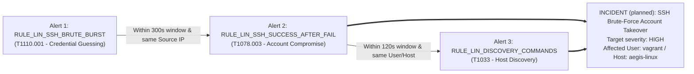
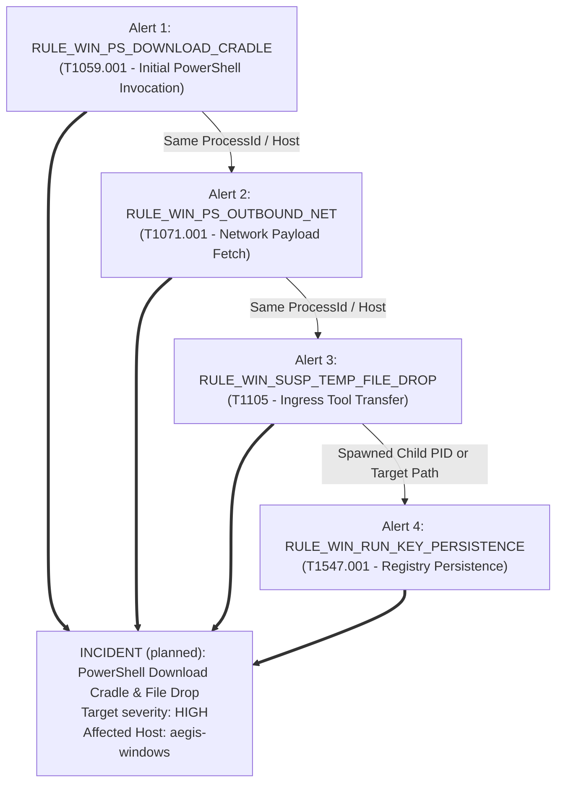

# AegisRange Evidence Mapping & Detection Engineering Matrix

This document maps adversary actions to the forensic evidence that operating system
telemetry subsystems produce, to candidate detection rules, and to the corresponding
**MITRE ATT&CK** techniques.

> [!IMPORTANT]
> **Scope: this is detection-engineering reference material, not a description of the running
> code.** The `RULE_*` identifiers, the MITRE technique IDs and the correlation chains in
> §3 are the detection logic the team is working *towards*. None of them exist in `main.py`,
> and none of them are stored anywhere: `models.py` has no `mitre_technique`, `rule_id`,
> `target_host`, `user_name` or `event_type` column, so the dashboard cannot display MITRE
> tags or rule names.
>
> What the backend actually does today is one volume rule: **3 or more logs from the same
> `source_ip` within 5 minutes** raise a single incident titled
> `Suspicious activity from <source_ip>`, whose severity escalates `low` (3–4) → `medium`
> (5–9) → `high` (10+). Those three lowercase values are the only severities the database
> has — **`critical` is not one of them.** See
> [`api-contracts.md`](api-contracts.md) §1.5 for the implemented behaviour.
>
> Use this document to decide *what to collect and why*; use `api-contracts.md` to decide
> *what to send and what you will get back*.

---

## 1. Scenario 1: SSH Brute-Force & Account Takeover (Linux Target)

This scenario simulates an external adversary on `aegis-kali` (`10.10.10.10`) performing automated credential guessing against the OpenSSH service on `aegis-linux` (`10.10.10.20`), culminating in successful credential access and post-compromise reconnaissance.

### 1.1 Attack-to-Evidence Matrix

| Phase # | Attack Step / Adversary Action | Forensic Evidence Generated | Telemetry Source | Exact Log Location / Channel | Detection Rule Identifier & Logic | MITRE ATT&CK ID & Name |
| :--- | :--- | :--- | :--- | :--- | :--- | :--- |
| **1.1** | **Port Scanning & Service Probe**: Adversary runs `nmap -sS -p 22 10.10.10.20` or initiates rapid TCP SYN handshakes. | Incomplete TCP handshakes / connection dropped entries; repeated connection attempts without auth. | Linux Kernel / Netfilter (`iptables` log prefix) | `/var/log/syslog` or `/var/log/kern.log` | `RULE_LIN_RECON_PORTSCAN` >10 SYN packets on target ports within 10 seconds. | [T1046](https://attack.mitre.org/techniques/T1046/): Network Service Discovery |
| **1.2** | **Credential Guessing Burst**: Hydra launches multi-threaded password brute-force against user accounts (`root`, `admin`, `ubuntu`, `test`). | Repetitive `Failed password for invalid user <user> from 10.10.10.10 port <port> ssh2` and `Failed password for <user>`. | OpenSSH Daemon / Linux PAM subsystem | `/var/log/auth.log` (or `systemd-journald` unit `ssh.service`) | `RULE_LIN_SSH_BRUTE_BURST` $\ge 5$ failed authentications from identical `source_ip` within a 60-second sliding window. | [T1110.001](https://attack.mitre.org/techniques/T1110/001/): Password Guessing |
| **1.3** | **Successful Authentication**: Hydra discovers the correct password for user `vagrant` or `alice` and completes login. | Single `Accepted password for <user> from 10.10.10.10 port <port> ssh2` followed by PAM session open. | OpenSSH Daemon / Linux PAM (`pam_unix`) | `/var/log/auth.log` | `RULE_LIN_SSH_SUCCESS_AFTER_FAIL` `auth_success` from an IP address that generated $\ge 3$ `auth_failure` events within the preceding 300 seconds. | [T1078.003](https://attack.mitre.org/techniques/T1078/003/): Local Accounts |
| **1.4** | **Interactive Session Initialization**: SSH daemon allocates pseudo-terminal (`pty`) and forks login shell for the authenticated user. | `pam_unix(sshd:session): session opened for user vagrant(uid=1000) by (uid=0)`. | Linux PAM subsystem (`sshd:session`) | `/var/log/auth.log` | `RULE_LIN_PAM_SESSION_OPEN` Session open event linked to preceding brute-force entity. | [T1059.004](https://attack.mitre.org/techniques/T1059/004/): Unix Shell |
| **1.5** | **Post-Compromise Discovery**: Adversary executes basic host reconnaissance (`whoami`, `id`, `uname -a`, `sudo -l`). | `COMMAND=/usr/bin/sudo -l` logged if sudo is attempted; auditd `EXECVE` records for spawned binaries. | Linux Audit Subsystem (`auditd`) / `sudo` log | `/var/log/auth.log` and `/var/log/audit/audit.log` | `RULE_LIN_DISCOVERY_COMMANDS` Execution of multiple enumeration binaries (`id`, `sudo -l`, `cat /etc/shadow`) within 60 seconds of logon. | [T1033](https://attack.mitre.org/techniques/T1033/): System Owner/User Discovery |

---

## 2. Scenario 2: Malicious PowerShell Dropper & Execution (Windows Target)

This scenario emulates an adversary executing a multi-stage living-off-the-land attack against `aegis-windows` (`10.10.10.30`). The adversary leverages a PowerShell cradle to retrieve a malicious stager, writes the artifact to disk, triggers process execution, and attempts persistence.

### 2.1 Attack-to-Evidence Matrix

| Phase # | Attack Step / Adversary Action | Forensic Evidence Generated | Telemetry Source | Exact Log Location / Channel | Detection Rule Identifier & Logic | MITRE ATT&CK ID & Name |
| :--- | :--- | :--- | :--- | :--- | :--- | :--- |
| **2.1** | **Download Cradle Execution**: PowerShell invoked with evasion arguments: `powershell.exe -NoP -NonI -W Hidden -Exec Bypass -Enc ...` downloading a staged script. | Sysmon Event ID 1 (Process Create) with `Image` containing `powershell.exe` and `CommandLine` containing download primitives (`Net.WebClient`, `DownloadString`, `Invoke-WebRequest`, or `-Enc`). | Microsoft-Windows-Sysmon | `Microsoft-Windows-Sysmon/Operational` (Event ID 1) | `RULE_WIN_PS_DOWNLOAD_CRADLE` PowerShell process creation with suspicious CLI tokens (`-enc`, `DownloadString`, `bypass`, `hidden`). | [T1059.001](https://attack.mitre.org/techniques/T1059/001/): PowerShell |
| **2.2** | **Network Connection Staging**: PowerShell initiates an outbound HTTP connection to `10.10.10.10:80` to retrieve payload. | Sysmon Event ID 3 (Network Connection) indicating `Image` = `powershell.exe`, `DestinationIp` = `10.10.10.10`, `DestinationPort` = `80`. | Microsoft-Windows-Sysmon | `Microsoft-Windows-Sysmon/Operational` (Event ID 3) | `RULE_WIN_PS_OUTBOUND_NET` PowerShell process initiating direct outbound TCP socket to non-standard or lab IP. | [T1071.001](https://attack.mitre.org/techniques/T1071/001/): Web Protocols |
| **2.3** | **Payload Dropped to Disk**: Dropper script writes executable or secondary script (`aegis_agent.bat` or `beacon.exe`) to a temporary staging path. | Sysmon Event ID 11 (File Create) where `TargetFilename` matches `C:\Users\*\AppData\Local\Temp\*` or `C:\Windows\Temp\*` created by `powershell.exe`. | Microsoft-Windows-Sysmon | `Microsoft-Windows-Sysmon/Operational` (Event ID 11) | `RULE_WIN_SUSP_TEMP_FILE_DROP` File creation in user or system Temp folder by script interpreter (`powershell.exe` / `cscript.exe`). | [T1105](https://attack.mitre.org/techniques/T1105/): Ingress Tool Transfer |
| **2.4** | **Secondary Process Spawning**: Dropper spawns executable or secondary interpreter: `cmd.exe /c C:\Windows\Temp\beacon.exe` or `certutil.exe`. | Sysmon Event ID 1 (Process Create) where `ParentImage` is `powershell.exe` and `Image` is `cmd.exe`, `certutil.exe`, or unsigned binary in `\Temp\`. | Microsoft-Windows-Sysmon | `Microsoft-Windows-Sysmon/Operational` (Event ID 1) | `RULE_WIN_SPAWNED_FROM_SCRIPT` Command prompt or utility spawned directly with `ParentImage` ending in `powershell.exe`. | [T1204.002](https://attack.mitre.org/techniques/T1204/002/): Malicious File |
| **2.5** | **Persistence via Run Key**: Dropped payload writes a persistence key to `HKCU\Software\Microsoft\Windows\CurrentVersion\Run`. | Sysmon Event ID 12 or 13 (Registry Object Added / Value Set) targeting the standard startup Run keys. | Microsoft-Windows-Sysmon | `Microsoft-Windows-Sysmon/Operational` (Event ID 12/13) | `RULE_WIN_RUN_KEY_PERSISTENCE` Registry value modification targeting `CurrentVersion\Run` or `RunOnce`. | [T1547.001](https://attack.mitre.org/techniques/T1547/001/): Registry Run Keys / Startup Folder |
| **2.6** | **Local Discovery**: Script invokes `whoami.exe /priv`, `net.exe user`, `ipconfig.exe /all`. | Sysmon Event ID 1 (Process Create) with short-lived recon binaries spawned in rapid succession by same parent PID. | Microsoft-Windows-Sysmon | `Microsoft-Windows-Sysmon/Operational` (Event ID 1) | `RULE_WIN_DISCOVERY_BURST` $\ge 3$ distinct discovery binaries spawned within 30 seconds by common parent process. | [T1087.001](https://attack.mitre.org/techniques/T1087/001/): Local Accounts |

---

## 3. Incident Correlation Matrix & Logic

A fundamental strength of AegisRange is its **Correlation Engine**, which groups individual low-level alerts into cohesive, multi-stage **Incidents**.

> [!CAUTION]
> The two correlation rules below are **planned design**, not implemented behaviour. The code
> has no alert objects, no process-tree or user-based matching, and no per-technique chain
> logic — only the `source_ip` volume threshold described above. "Promoted Severity" values
> are therefore target values, and would have to be expressed as `high` until a `critical`
> value is added to `models.py`.

### 3.1 Correlation Rule 1: SSH Brute-Force to Compromise (`INCIDENT_SSH_TAKEOVER`)

- **Correlation Criteria**:
  - `source_ip` of failed login alerts matches `source_ip` of successful login alert.
  - `target_host` matches (`aegis-linux` / `10.10.10.20`).
  - Time interval between the last failed login burst and successful authentication is $\le 300\text{ seconds}$.
- **Promoted Severity** *(planned)*: `high` — the highest value `models.py` currently allows.
- **Intended Incident Description** *(planned)*: *"Adversary at 10.10.10.10 conducted an automated SSH brute-force attack against aegis-linux resulting in unauthorized authentication for user 'vagrant' followed by discovery commands."*
- **Today instead**: `"<count> logs received from 10.10.10.10 within the last 5 minutes."` — the engine has no notion of users, hosts or attack stages.

---

### 3.2 Correlation Rule 2: Multi-Stage PowerShell Infection Chain (`INCIDENT_WIN_MALWARE_DROP`)

- **Correlation Criteria**:
  - `ProcessId` of the network connection matches the `ProcessId` of the initial suspicious PowerShell execution.
  - `TargetFilename` dropped within 30 seconds of the network connection.
  - Registry modification matches the dropped executable path or occurs under the same parent process tree.
- **Sliding Window** *(planned)*: 180 seconds total chain window. The implemented window is a
  flat 5 minutes (`TIME_WINDOW` in `main.py`).
- **Promoted Severity** *(planned)*: `high` — the highest value `models.py` currently allows.
- **Intended Incident Description** *(planned)*: *"PowerShell execution cradle initiated network connection to 10.10.10.10, dropped executable payload to Temp directory, and established registry persistence on aegis-windows."*

---

## 4. Normalization Field Reference for Rule Matching

Collectors should populate the following core normalized keys so that the planned rules can
evaluate deterministically.

> [!NOTE]
> Only `source_ip` and `destination_ip` are top-level fields on `POST /api/logs` today, and
> only `source_ip` affects correlation. Every other key in this table goes inside the
> request's `raw_data` object, where it is stored verbatim and shown by the dashboard — but
> nothing matches on it yet.

| Unified Field Name | Linux (`auth.log`) Source | Windows (`Sysmon`) Source | Rule Usage |
| :--- | :--- | :--- | :--- |
| `event_type` | `auth_failure`, `auth_success`, `session_open` | `process_creation`, `network_connection`, `file_creation`, `registry_modification` | Primary rule filter |
| `source_ip` | IP parsed from `from <IP>` | `Event.EventData.SourceIp` | Brute-force & network correlation |
| `destination_ip` | IP of Linux target interface (`10.10.10.20`) | `Event.EventData.DestinationIp` | Network connection correlation |
| `source_host` | System hostname (`aegis-linux`) | System hostname (`aegis-windows`) | Host grouping |
| `user_name` | Parsed from `for invalid user <name>` / `for <name>` | `Event.EventData.User` | Identity correlation |
| `process_path` | `/usr/sbin/sshd`, `/usr/bin/sudo` | `Event.EventData.Image` | Executable signature matching |
| `process_command_line` | Command executed via sudo or shell | `Event.EventData.CommandLine` | Substring and regex matching |
| `process_id` | Linux daemon PID | `Event.EventData.ProcessId` | Process tree lineage tracking |
| `parent_process_id` | PPID | `Event.EventData.ParentProcessId` | Ancestry evaluation |
| `target_path` | N/A | `Event.EventData.TargetFilename` or `TargetObject` | File and registry target matching |
