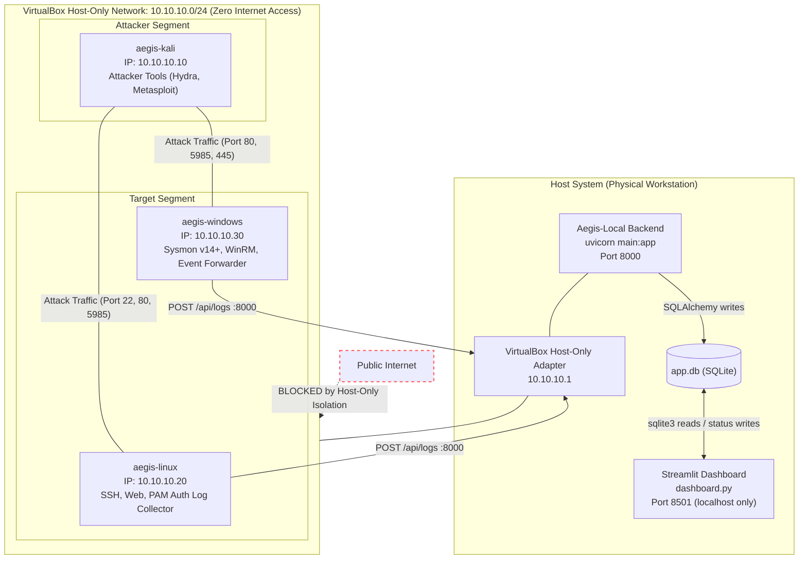

# AegisRange Network Topology & Security Architecture

This document specifies the network architecture, IP addressing scheme, port allocation, routing constraints, firewall policies, and containment security practices implemented within the **AegisRange** laboratory environment.

---

## 1. Network Design & Subnet Architecture

The primary design principle of AegisRange is **strict containment**. All virtual machines reside on a single, private, isolated **VirtualBox Host-Only Network** operating on the IPv4 subnet `10.10.10.0/24`.

- **Subnet CIDR**: `10.10.10.0/24`
- **Subnet Mask**: `255.255.255.0`
- **Network Identifier**: `10.10.10.0`
- **Broadcast Address**: `10.10.10.255`
- **Host Gateway / Management Interface**: `10.10.10.1`
- **VirtualBox Adapter Type**: Host-Only Adapter (`VirtualBox Host-Only Ethernet Adapter` on Windows; `vboxnet0` on Linux/macOS)
- **DHCP Service**: Disabled on the host-only adapter to ensure deterministic static IP addressing across reboots and rebuilds.

---

## 2. IP Address Allocations

All entities inside the lab are assigned static IP addresses defined in the project's root `Vagrantfile`:

| IP Address | Hostname / Entity | Operating System | Role in Range | RAM / vCPU |
| :--- | :--- | :--- | :--- | :--- |
| `10.10.10.1` | `host.aegis.local` | Windows / Linux / macOS | Lab Management, Aegis-Local Core Engine, REST API, Web UI | Host machine |
| `10.10.10.10` | `aegis-kali` | Kali Linux 2023.x / 2024.x | Attacking Node (Adversary Emulation) | 2048 MB / 2 vCPU |
| `10.10.10.20` | `aegis-linux` | Ubuntu Server 22.04 LTS | Victim Target 1 (Linux Server) | 2048 MB / 2 vCPU |
| `10.10.10.30` | `aegis-windows` | Windows 10 Enterprise (Eval) | Victim Target 2 (Windows Workstation) | 4096 MB / 2 vCPU |

---

## 3. Network Topology Diagram



---

## 4. Port Allocations & Service Mapping

The following services and network ports are active across the lab environment:

| Port | Protocol | Source Entity | Destination Entity | Service / Function | Description |
| :--- | :--- | :--- | :--- | :--- | :--- |
| `22` | TCP | `10.10.10.10` / `10.10.10.1` | `10.10.10.20` | SSH (OpenSSH Daemon) | Target for Scenario 1 brute-force attack; management shell access. |
| `21` | TCP | `10.10.10.10` | `10.10.10.20` | FTP (vsftpd) | Auxiliary target service for credential brute-force simulation. |
| `80` | TCP | `10.10.10.10` | `10.10.10.20` / `10.10.10.30` | HTTP Web Server | Target web application for initial reconnaissance and payload hosting. |
| `445` | TCP | `10.10.10.10` | `10.10.10.30` | SMB / CIFS | Windows file sharing and lateral movement emulation. |
| `5985` | TCP | `10.10.10.10` / `10.10.10.1` | `10.10.10.30` | WinRM (HTTP) | Windows Remote Management; attack trigger execution and telemetry collector control. |
| `8000` | TCP / HTTP | `10.10.10.20` / `10.10.10.30` | `10.10.10.1` | Aegis-Local REST API (uvicorn) | Collector endpoint for `POST /api/logs` telemetry submission; also serves `GET /api/incidents`, `GET /api/scenarios` and `/docs`. Requires `uvicorn main:app --host 0.0.0.0` to be reachable from the VMs. |
| `8501` | TCP / HTTP | Host Browser (`localhost`) | `127.0.0.1` | Streamlit investigation dashboard | `dashboard.py`. Host-local only; the lab VMs never connect to it, and it never connects to port 8000 — it reads `app.db` off the host filesystem. |

> [!NOTE]
> Earlier drafts of this document listed ports `8080` (API), `5044` (a dedicated forwarder
> transport) and `3000` (a Next.js UI). None of those are used: the API is uvicorn on
> **8000**, the dashboard is Streamlit on **8501**, and there is no separate forwarder
> transport or Node.js service.

---

## 5. Traffic Flow & Firewall Rules

To uphold realistic attack scenarios while preventing accidental network compromise or uncontrolled spread, strict host-level and guest-level firewall rules are enforced.

### 5.1 Egress & Internet Blocking (Target Systems)
Neither `aegis-linux` nor `aegis-windows` has a default gateway pointing to the public Internet on their host-only interfaces.
- Vagrant creates a default NAT interface (Adapter 1) solely for provisioning (`apt update`, installing packages). Once provisioning is complete, this adapter is disabled or routing priority is stripped, preventing targets from initiating any outbound Internet connections.
- All target updates and packages are installed strictly during the initial `vagrant up` provisioning phase.

### 5.2 Attacker Confinement (`aegis-kali`)
The attacker node `aegis-kali` is explicitly restricted to communicate solely with the target hosts on the host-only subnet:
- **Allowed destinations**:
  - `10.10.10.20` (Linux Target)
  - `10.10.10.30` (Windows Target)
- **Blocked destinations**:
  - `10.10.10.1` (Host management ports: no unauthorized attacks against host services)
  - Physical LAN subnets (`192.168.x.x`, `10.x.x.x` physical networks, `172.16.x.x`)
  - WAN / Public Internet destinations during attack execution.

### 5.3 Target Firewall Rules (iptables & Windows Defender Firewall)

#### Linux Target (`10.10.10.20`) Rules
```bash
# Flush default chains
iptables -F
iptables -X

# Set Default Policies
iptables -P INPUT DROP
iptables -P FORWARD DROP
iptables -P OUTPUT ACCEPT

# Allow loopback
iptables -A INPUT -i lo -j ACCEPT

# Allow established and related traffic
iptables -A INPUT -m conntrack --ctstate ESTABLISHED,RELATED -j ACCEPT

# Allow SSH and HTTP only from Host-Only subnet (10.10.10.0/24)
iptables -A INPUT -p tcp -s 10.10.10.0/24 --dport 22 -j ACCEPT
iptables -A INPUT -p tcp -s 10.10.10.0/24 --dport 80 -j ACCEPT
iptables -A INPUT -p icmp -s 10.10.10.0/24 -j ACCEPT

# Log dropped packets (Optional for firewall audit)
iptables -A INPUT -j LOG --log-prefix "FW_DROPPED: " --log-level 7
```

#### Windows Target (`10.10.10.30`) Firewall Configuration
```powershell
# Enable Windows Defender Firewall for all profiles
Set-NetFirewallProfile -Profile Domain,Public,Private -Enabled True

# Block all unsolicited inbound connections by default
Set-NetFirewallProfile -DefaultInboundAction Block

# Allow WinRM from Host-Only subnet (for lab automation and testing)
New-NetFirewallRule -DisplayName "AegisRange-WinRM" `
    -Direction Inbound -LocalPort 5985 -Protocol TCP `
    -RemoteAddress 10.10.10.0/24 -Action Allow

# Allow SMB inbound from Host-Only subnet
New-NetFirewallRule -DisplayName "AegisRange-SMB" `
    -Direction Inbound -LocalPort 445 -Protocol TCP `
    -RemoteAddress 10.10.10.0/24 -Action Allow

# Allow ICMP Echo Request from Host-Only subnet
New-NetFirewallRule -DisplayName "AegisRange-ICMP" `
    -Direction Inbound -Protocol ICMPv4 `
    -RemoteAddress 10.10.10.0/24 -Action Allow
```

---

## 6. Security Considerations & Safety Controls

Running adversary emulation tools within a development environment requires strict adherence to security controls:

### 1. Host-Only Network Isolation
The `VirtualBox Host-Only Adapter` does not bridge traffic to the host's physical network adapter (Wi-Fi or Ethernet). Packets routed within `10.10.10.0/24` cannot leave the physical computer, eliminating the risk of accidental denial-of-service (DoS) or port scanning against university or corporate LANs.

### 2. Harmless, Predictable Attack Payloads
All payloads utilized in Scenario 2 (Windows Malicious Execution) execute simulated and benign operational actions:
- Dropping benign marker files (`C:\Windows\Temp\aegis_beacon.txt`).
- Reading non-sensitive environment variables (`$env:COMPUTERNAME`, `$env:USERNAME`).
- Executing standard Windows diagnostic utilities (`whoami.exe`, `net.exe user`).
- Payloads **never** make outbound connections to real external Command and Control (C2) servers or execute damaging file encryption routines.

### 3. Credential Segregation
All target user accounts created for the lab (e.g., `vagrant`, `alice`, `svc-web`) use isolated lab-specific passwords (e.g., `Password123!`, `Summer2026!`). No real personal or corporate passwords or tokens are used within the range.

### 4. Deterministic VM Snapshots
Before executing any scenario:
- A clean baseline snapshot is recorded: `vagrant snapshot save baseline-ready`.
- Following scenario execution and triage, the environment can be returned to clean state instantly via `vagrant snapshot restore baseline-ready`, discarding all disk modifications and memory artifacts.
